# 🛡️ Hardened Master Engine v3.6 DataSphere Ultra

Техническая документация узла сетевой маскировки и туннелирования трафика: OS Hardening, TCP BBR, Nginx L4 Stream Router, 3X-UI, Xray Core v26.7.28 (Pinned), VLESS xHTTP (Native H2 Stream-One / ML-KEM-768), VLESS REALITY (Steal-Oneself & Classic), Hysteria 2, AdGuard Home DoH, нативный сервер AmneziaWG в ядре Linux (DKMS Bare-Metal, профиль AWG3), сетевой экран UFW, шлюз управления DataSphere SSO Hub и клиентская интеграция с роутерами OpenWrt (Podkop) / KeeneticOS.

---

## 📑 Содержание

1. [Сетевая архитектура и топология](#1-сетевая-архитектура-и-топология)
2. [Матрица сетевых сокетов и портов](#2-матрица-сетевых-сокетов-и-портов)
3. [Режимы развёртывания и архитектура миграции (Safe Migration)](#3-режимы-развёртывания-и-архитектура-миграции-safe-migration)
4. [Протоколы туннелирования и маскировки](#4-протоколы-туннелирования-и-маскировки)
5. [Маршрутизация, NAT и безопасность (UFW)](#5-маршрутизация-nat-и-безопасность-ufw)
6. [Веб-маскировка и административный шлюз (DataSphere SSO)](#6-веб-маскировка-и-административный-шлюз-datasphere-sso)
7. [Системные требования и установка](#7-системные-требования-и-установка)
8. [Параметры мастера установки](#8-параметры-мастера-установки)
9. [Клиентские конфигурации, подписки и интеграция с роутерами (OpenWrt / Keenetic)](#9-клиентские-конфигурации-подписки-и-интеграция-с-роутерами-openwrt--keenetic)
10. [Приватный DoH AdGuard Home](#10-приватный-doh-adguard-home)
11. [Диагностика и мониторинг](#11-диагностика-и-мониторинг)
12. [Резервное копирование и восстановление](#12-резервное-копирование-и-восстановление)

---

## 1. Сетевая архитектура и топология

Входящий трафик разделен на два изолированных контура:

1. **TCP-контур (Порт 80 и 443):**
   * **Порт 80:** Обрабатывает исключительно проверку доменов Certbot ACME HTTP-01 (`/.well-known/acme-challenge/`). Неавторизованные обращения и сканеры сбрасываются соединением `return 444`.
   * **Порт 443 (Nginx L4 Stream Router):** Модуль `ngx_stream_core_module` выполняет предварительную маршрутизацию TCP-пакетов без терминации TLS на основе `ssl_preread`:
     * Обращения к основному домену (`yourdomain.online`) и DNS (`dns.yourdomain.online`) направляются в локальный сокет `/dev/shm/nginx-http.sock`;
     * Обращения к поддомену маскировки (`cdn.yourdomain.online`) пересылаются на инбаунд Xray Steal REALITY (`127.0.0.1:45443`);
     * Обращения с внешним SNI (`gateway.icloud.com`) пересылаются на инбаунд Xray Classic REALITY (`127.0.0.1:46443`);
     * Прямые запросы по IP-адресу или неизвестным доменам отсекаются директивой `ssl_reject_handshake on` (Zero-SNI Shield).
   * **Anti-Loop Fallback (Порт 9443):**
     * Инбаунд Steal REALITY пересылает не-VPN трафик через PROXY protocol v1 (`xver: 1`) на хост `02-steal-fallback.conf` (`127.0.0.1:9443`). Nginx отвечает легитимным сертификатом `cdn.*`, исключая обрыв TLS-хэндшейка.

2. **UDP-контур (Скоростные пулы и туннели):**
   * **Hysteria 2:** Базовый сокет `443/udp`. Скоростной пул `20000:35000/udp` перенаправляется средствами фаервола UFW на базовый порт.
   * **Native Kernel AmneziaWG (awg0):** Базовый сокет ядра `8443/udp`. Пул `35001:49999/udp` перенаправляется средствами UFW на сокет `8443/udp`.
   * **3X-UI UDP Stack:** Изолированные порты `10443/udp` (AWG v3.2), `10444/udp` (AWG v2.0 Legacy) и `10445/udp` (3X WireGuard).

```mermaid
flowchart TD
    ClientTCP["Клиент: TCP (HTTPS, REALITY, xHTTP, ACME)"] -->|TCP 80 / 443| NginxL4["Nginx L4 Stream Router (:443)"]
    ClientUDP["Клиент: UDP (Hy2, Kernel AWG, AWG v3/v2, WG)"] -->|Диапазоны UDP| UFW_Rules["Фаервол UFW (Фильтрация и NAT)"]

    subgraph TCP_Pipeline ["Маршрутизация TCP"]
        Port80["Порт :80"] -->|ACME HTTP-01| ACME["Webroot: /.well-known/acme-challenge/"]
        Port80 -->|Сканеры / Боты| Drop444["TCP Reset: return 444"]

        NginxL4 -->|"SNI: cdn.*"| XraySteal["Xray Steal REALITY :45443"]
        NginxL4 -->|"SNI: gateway.icloud.com"| XrayClassic["Xray Classic REALITY :46443"]
        NginxL4 -->|"SNI: yourdomain / dns.*"| SockRAM["Unix-Socket: /dev/shm/nginx-http.sock"]

        XraySteal -->|"Fallback / PROXY v1"| VhostFallback["Nginx Fallback :9443 (cdn.* SSL)"]
        XrayClassic -->|"Fallback Direct"| ExtTarget["Внешний узел :443"]

        SockRAM -->|"Прямой IP / Неизвестный SNI"| ZeroSNI["Zero-SNI: ssl_reject_handshake"]
        SockRAM -->|"TLS 1.3 / H2"| NginxL7["Nginx L7 Web Gateway"]

        NginxL7 -->|"URI: /"| Decoy["DataSphere SPA (Zero-Inline)"]
        NginxL7 -->|"URI: /api/v1/datasphere/"| CoreDaemon["DataSphere Core Daemon :20443"]
        NginxL7 -->|"URI: /my-3x-panel/"| PanelUI["3X-UI Панель :10443 (Loopback)"]
        NginxL7 -->|"URI: /my-post-key/"| SubServer["3X-UI Подписки :55443 (Loopback)"]
        NginxL7 -->|"URI: /xhttp-stream/ (POST)"| XrayXHTTP["Xray VLESS xHTTP :50443 (H2 Stream)"]
        NginxL7 -->|"SNI: dns.* /dns-query"| AGH["AdGuard Home :3000 / :53"]
    end

    subgraph UDP_Pipeline ["Маршрутизация UDP"]
        UFW_Rules -->|"REDIRECT 20000:35000 -> :443"| XrayHy2["Hysteria 2 UDP :443 (QUIC)"]
        UFW_Rules -->|"REDIRECT 35001:49999 -> :8443"| KernelAWG["Kernel AmneziaWG awg0 :8443 (AWG3)"]
        UFW_Rules -->|"Прямой порт :10443"| AWG3["AmneziaWG v3.2 3X-UI :10443"]
        UFW_Rules -->|"Прямой порт :10444"| AWG2["AmneziaWG v2.0 3X-UI :10444"]
        UFW_Rules -->|"Прямой порт :10445"| WG3X["3X WireGuard 3X-UI :10445"]
    end
```



---

## 2. Матрица сетевых сокетов и портов

| Протокол / Служба | L4 Сокет | Область видимости | Назначение |
| :--- | :--- | :--- | :--- |
| **ACME Bootstrap** | `80/tcp` | Публичная | Валидация сертификатов Certbot HTTP-01 |
| **Nginx L4 Ingress** | `443/tcp` | Публичная | Единая входная точка TLS/TCP, роутинг по SNI |
| **Nginx Fallback** | `127.0.0.1:9443` | Локальная | Терминация fallback-трафика Steal REALITY (`cdn.*`) |
| **DataSphere Core** | `127.0.0.1:20443`| Локальная | Демон аутентификации SSO и API управления `awg0` |
| **3X-UI Web Panel** | `127.0.0.1:10443`| Локальная | Интерфейс администратора 3X-UI |
| **3X-UI Subscriptions**| `127.0.0.1:55443`| Локальная | Сервер выдачи клиентских подписок |
| **VLESS xHTTP** | `127.0.0.1:50443`| Локальная | H2 бэкенд xHTTP Stream-One (ML-KEM-768) |
| **VLESS Steal REALITY**| `127.0.0.1:45443`| Локальная | Инбаунд Steal-Oneself REALITY (PROXY proto v1) |
| **VLESS Classic REALITY**| `127.0.0.1:46443`| Локальная | Инбаунд Classic REALITY (`gateway.icloud.com`) |
| **AdGuard Home Web** | `127.0.0.1:3000` | Локальная | Веб-интерфейс управления AdGuard Home |
| **AdGuard Home DNS** | `127.0.0.1:53` / `10.9.0.1:53` | Локальная | Локальный и туннельный DNS-резолвер |
| **Hysteria 2** | `443/udp` | Публичная | Базовый порт Hysteria 2 (QUIC) |
| **Hy2 Hopping Pool**| `20000:35000/udp`| Публичная | Пул динамической ротации портов Hysteria 2 |
| **Kernel AmneziaWG** | `8443/udp` | Публичная | Базовый сокет ядра `awg0` (DKMS Bare-Metal) |
| **AWG Native Pool** | `35001:49999/udp`| Публичная | Скоростной мультипортовый пул для `awg0` |
| **3X-UI AWG v3.2** | `10443/udp` | Публичная | Инбаунд AWG v3.2 в 3X-UI (подсеть `10.8.1.0/24`) |
| **3X-UI AWG v2.0** | `10444/udp` | Публичная | Инбаунд AWG v2.0 в 3X-UI (подсеть `10.8.2.0/24`) |
| **3X WireGuard** | `10445/udp` | Публичная | Инбаунд WireGuard в 3X-UI (подсеть `10.8.3.0/24`) |

---

## 3. Режимы развёртывания и архитектура миграции (Safe Migration)

В ревизии v3.6 полностью переработан механизм наката обновлений и миграции базы данных.

### Принципы Safe Migration Mode (`INSTALL_MODE="2"`):
1. **Защита пользовательских наименований (`remark`):**
   * Скрипт не перезаписывает названия действующих инбаундов в таблице `inbounds`. Кастомные имена (например, `REALITY-45443`) сохраняются в неизменном виде.
   * Имена в таблице `hosts` не сбрасываются на шаблоны установщика.
2. **Изоляция клиентской базы и подписок:**
   * Существующие клиенты **не привязываются принудительно** к новым инбаундам. Топология привязок в таблицах `client_inbounds` и `client_traffics` остаётся строго в состоянии, заданном администратором.
   * Полная привязка всех инбаундов выполняется исключительно для тестового клиента `Test` при чистой установке (`INSTALL_MODE="1"`).
   * URI-пути подписок, персональные токены `subId` и модели ссылок не мутируют.
3. **Фоновая нормализация схемы под валидатор Zod (3X-UI v2.4+ / v3.10+):**
   * Поле `settings.encryption` в инбаундах VLESS приводится к значению `"none"` вместо недопустимой пустой строки `""` (устранена ошибка `expected string to have >=1 characters`).
   * Параметры `alpn` и `pinnedPeerCertSha256` внутри `streamSettings.externalProxy` безусловно приводятся к типу массивов (`list`), предотвращая сбой `expected array, received string`.
4. **Интеллектуальное автоопределение параметров xHTTP:**
   * При наличии существующей базы мастер считывает рабочий путь (например, `/xhttp-stream/`) и локальный порт из SQLite, исключая перезапись дефолтным значением `Stream-One-Path`.
5. **Детекция установки 3X-UI по бинарнику:**
   * Проверка развёртывания панели переведена на наличие исполняемого файла `/usr/local/x-ui/x-ui`, а не файла `/etc/x-ui/x-ui.db`. Это позволяет распаковывать резервную копию базы данных на чистую ОС до запуска инсталлятора без риска пропуска установки исполняемых файлов и systemd-службы.
6. **Консистентность транзакций SQLite WAL:**
   * На ключевых этапах миграции (перед архивацией, до и после применения правок) принудительно вызываются `PRAGMA wal_checkpoint(FULL)` и `PRAGMA wal_checkpoint(TRUNCATE)`, гарантируя сброс буфера `x-ui.db-wal` в основной файл `x-ui.db`.

---

## 4. Протоколы туннелирования и маскировки

### 1. VLESS xHTTP (Native H2 Stream-One + ML-KEM-768)
* **Проксирование Nginx:** Трафик проксируется как полнодуплексный HTTP/2-поток через `proxy_pass http://127.0.0.1:50443` с принудительно отключённой буферизацией (`proxy_request_buffering off; proxy_buffering off;`) и опцией `tcp_nodelay on`. Директива `grpc_pass` исключена во избежание сбоев gRPC-фрейминга.
* **Постквантовое шифрование:** Генерация ключей выполняется средствами ядра Xray (`vlessenc`). Поддерживается алгоритм **ML-KEM-768** (дешифрование на сервере, шифрование на клиенте).

### 2. VLESS REALITY (Steal-Oneself & Classic External)
* **Steal-Oneself (`:45443`):** Маскировка под собственный поддомен `cdn.yourdomain.online`. Внутренний целевой адрес fallback — `127.0.0.1:9443` с заголовком PROXY protocol v1 (`xver: 1`).
* **Classic External (`:46443`):** Маскировка под внешний доверенный SNI (по умолчанию `gateway.icloud.com` или `tbank.ru` при RU-профиле). Выбор SNI оптимизируется замером сетевой задержки RTT.

### 3. Hysteria 2 UDP
* Базовый порт `:443/udp` (QUIC). Поддержка скоростного пула Port Hopping `20000:35000/udp` через правила редиректа UFW. Маскировка HTTP через `http://127.0.0.1:80`.

### 4. Нативный сервер AmneziaWG (Ядро Linux `awg0`, профиль AWG3)
Спецификация параметров исключает совпадение сигнатурных длин пакетов на узлах ТСПУ:
* Формулы длин:
  $$\mathbf{S1 + 56 \neq S2} \quad (72 + 56 = 128 \neq 56) \quad \text{— разделение Init (148B) и Response (92B)}$$
  $$\mathbf{S3 \neq S2 + 28} \quad (32 \neq 56 + 28 = 84) \quad \text{— разделение Response (92B) и Cookie (64B)}$$
  $$\mathbf{S1, S2, S3, S4 \ge 12} \quad \text{— извлечение ChaCha20 Nonce}$$
* Параметры обфускации:
  * `MTU = 1360`, `TCPMSS = 1320`;
  * `Jc = 4`, `Jmin = 40`, `Jmax = 70`;
  * `S1 = 72`, `S2 = 56`, `S3 = 32`, `S4 = 16`;
  * `H1..H4`: Фиксированные 32-битные скаляры в диапазоне от $10^7$ до $2147483647$ (гарантируют совместимость с роутерами Keenetic / OpenWrt);
  * `AllowedIPs = 0.0.0.0/0` (без `::/0` во избежание сброса маршрута при отключенном IPv6).

---

## 5. Маршрутизация, NAT и безопасность (UFW)

Фильтрация, трансляция адресов (NAT) и фиксация MSS централизованы в конфигурации сетевого экрана **UFW** (`/etc/ufw/before.rules`):

1. **Редирект скоростных пулов (PREROUTING):**
   * Hysteria 2: `20000:35000/udp` $\to$ `:443/udp`.
   * AmneziaWG Native: `35001:49999/udp` $\to$ `:8443/udp`.
2. **Маскарадинг подсетей (POSTROUTING MASQUERADE):**
   * Трафик подсетей `10.9.0.0/24` (`awg0`), `10.8.1.0/24`, `10.8.2.0/24` и `10.8.3.0/24` маскарадится через внешний сетевой интерфейс (`eth0` / динамически определяемый через Tier 1–4).
3. **Фиксация максимального размера сегмента (TCP MSS Clamping):**
   * Принудительная установка `TCPMSS 1320` для туннелей AmneziaWG и `1380` для WireGuard в таблице `*mangle`.
4. **Защита сокетов:**
   * Внутренние служебные порты (`10443`, `55443`, `50443`, `45443`, `46443`, `9443`, `3000`, `20443`) заблокированы на внешнем интерфейсе правилами `ufw deny`.

---

## 6. Веб-маскировка и административный шлюз (DataSphere SSO)

* **SPA-маскировка DataSphere Analytics Enterprise:**
  * Каталог: `/var/www/html`.
  * Архитектура Zero-Inline: строгая политика Content Security Policy (`default-src 'self'`), отсутствие инлайн-скриптов, локальные ресурсы стилей и скриптов.
* **In-Memory SSO Gateway:**
  * Кнопка «Консоль» открывает форму аутентификации.
  * Запрос валидируется сервисом `datasphere-core.py` (`127.0.0.1:20443`) с константным сравнением пароля через `hmac.compare_digest`.
  * При успешной аутентификации в памяти браузера динамически рендерится **DataSphere Infrastructure Hub**:
    1. Переход в панель 3X-UI;
    2. Панель мониторинга и управления пирами `awg0` ядра Linux (добавление клиентов, выгрузка конфигураций `.conf`, QR-код);
    3. Переход в AdGuard Home.

---

## 7. Системные требования и установка

### Поддерживаемые ОС:
* Ubuntu 22.04 / 24.04 / 26.04 LTS
* Debian 12 / 13

### Предварительные требования:
* Права суперпользователя `root`.
* DNS A-записи домена и поддоменов (`yourdomain.online`, `cdn.yourdomain.online`, `dns.yourdomain.online`) направлены на IPv4-адрес сервера.
* В Cloudflare для всех записей установлен режим **DNS-Only (Серое облако)**.

### Запуск установки:
```bash
bash <(curl -fsSL https://raw.githubusercontent.com/Itman75/Nginx-L4-Stream-Router-Mask-for-3x-ui/main/install.sh)
```

---

## 8. Параметры мастера установки

| Параметр | Значение по умолчанию | Описание |
| :--- | :--- | :--- |
| **Режим установки** | `2` (при наличии БД) | `1` — Clean Install; `2` — Safe Migration (сохранение клиентов, UUID, ключей, названий инбаундов). |
| **Гео-профиль** | Автоопределение | Системный DNS (Яндекс `77.88.8.8` для РФ / Cloudflare `1.1.1.1` для зарубежных узлов). |
| **Основной домен** | — | FQDN узла (`yourdomain.online`). |
| **Порт SSH** | Текущий активный | Опциональная смена порта, ключи Ed25519, интеграция с Fail2ban. |
| **Пути и порты 3X-UI** | Из базы / `:10443`, `:55443` | Внутренние сокеты панели и сервера подписок. |
| **VLESS xHTTP** | Из базы / `:50443`, `/xhttp-stream/`| Внутренний сокет и URI потокового транспорта HTTP/2. |
| **Steal REALITY** | `:45443` | Поддомен `cdn.yourdomain.online`, Fallback на Nginx `:9443` (PROXY proto v1). |
| **Classic REALITY** | `:46443` | Внешний SNI `gateway.icloud.com` (Apple) с замером задержки RTT. |
| **Hysteria 2** | `:443/udp` | Включение пула Port Hopping `20000:35000/udp`. |
| **Kernel AmneziaWG** | `:8443/udp` | Активация интерфейса ядра `awg0` и пула `35001:49999/udp`. |
| **3X-UI UDP Туннели** | `:10443`, `:10444`, `:10445` | Выделенные сокеты для AWG v3.2, AWG v2.0 и Native WireGuard. |
| **AdGuard Home DoH** | `dns.yourdomain.online` | Установка приватного DoH с проверкой токена `ClientID`. |
| **SSL Движок** | Certbot HTTP-01 | Нативный выпуск сертификатов Let's Encrypt через `/var/www/html`. |

---

## 9. Клиентские конфигурации, подписки и интеграция с роутерами (OpenWrt / Keenetic)

Реквизиты доступа сохраняются в `/root/vpn_credentials.txt` (`chmod 600`).

### Точки подключения и подписки:
* **Адаптивная подписка (Base64 / Clash Auto-Detect):**  
  `https://yourdomain.online/my-post-key/SUB_Test`
* **Подписка JSON (Sing-box v1.10+):**  
  `https://yourdomain.online/my-post-key/sub-json/SUB_Test`
* **Подписка Clash / Mihomo YAML:**  
  `https://yourdomain.online/sub-clash/SUB_Test`
* **Клиентский профиль Native Kernel AmneziaWG (`/root/amneziawg-client.conf`):**

```ini
[Interface]
Address = 10.9.0.2/32
PrivateKey = КЛИЕНТСКИЙ_PRIVATE_KEY
DNS = 10.9.0.1
MTU = 1360
Jc = 4
Jmin = 40
Jmax = 70
S1 = 72
S2 = 56
S3 = 32
S4 = 16
H1 = 138104463
H2 = 465648900
H3 = 1351372787
H4 = 138617230

[Peer]
PublicKey = СЕРВЕРНЫЙ_PUBLIC_KEY
Endpoint = yourdomain.online:8443
AllowedIPs = 0.0.0.0/0
PersistentKeepalive = 25
```

> [!NOTE]
> В качестве `Endpoint` для AmneziaWG допустимо использовать базовый порт `:8443` либо любой порт из диапазона `:35001-49999` (например, `yourdomain.online:39415`).

### Интеграция с роутерами OpenWrt (Пакет Podkop)
Пакет **Podkop** на базе OpenWrt обеспечивает выборочный обход блокировок и нативную работу со сформированным узлом:

1. **Импорт конфигурации туннеля (Sing-box / Xray / AWG):**
   * **Службы** $\to$ **Podkop** $\to$ **Поставщики прокси** (Proxy Providers).
   * Добавить новый источник:
     * Тип: `Sing-box JSON` (рекомендуется) или `VLESS / WireGuard`;
     * URL подписки: `https://yourdomain.online/my-post-key/sub-json/SUB_Test`;
     * Период обновления: `12ч` (или по расписанию).
   * *Для прямого использования AmneziaWG:* Установить пакет `kmod-amneziawg` / `amneziawg-tools` и импортировать файл `/root/amneziawg-client.conf` как нативный интерфейс в LuCI Network $\to$ Interfaces.
2. **Параметры маршрутизации и обхода:**
   * В настройках Podkop выбрать созданный провайдер прокси для списков обхода (Гео-IP / доменные списки).

### Логика назначения параметра `DNS`:
1. `DNS = 10.9.0.1` — при включённом AdGuard Home (запросы идут в туннель на локальный фильтрующий резолвер).
2. `DNS = 1.1.1.1, 8.8.8.8` — профиль EU/World.
3. `DNS = 77.88.8.8, 77.88.8.1` — профиль RU (Яндекс.DNS).

---

## 10. Приватный DoH AdGuard Home

Служба изолирована на `127.0.0.1:3000` и обслуживается через прокси Nginx с проверкой `ClientID`. Порт 53 закрыт извне.

* **Панель управления DNS:** `https://dns.yourdomain.online/`
* **DoH URL для клиентов:** `https://dns.yourdomain.online/dns-query/home-router`

### Настройка роутера OpenWrt (Пакет Podkop / Https-DNS-Proxy):
1. **Службы** $\to$ **Podkop** $\to$ **Настройки** (вкладка DNS):
   * Протокол: `DNS через HTTPS (DoH)`;
   * Строка подключения (URL): `https://dns.yourdomain.online/dns-query/home-router`;
   * Bootstrap DNS: `77.88.8.8` (для РФ) или `1.1.1.1` (для Зарубежья).
2. Сохранить настройки и перезапустить службу Podkop для маршрутизации DNS-запросов через AdGuard Home.

### Настройка роутера Keenetic (KeeneticOS):
1. **Сетевые правила** $\to$ **Интернет-фильтр** (вкладка «Серверы DNS»).
2. Добавить DNS-сервер:
   * Адрес DNS (Bootstrap): `77.88.8.8` или `1.1.1.1` *(не указывать IP своего VPS)*;
   * Протокол: `DNS-over-HTTPS (DoH)`;
   * URL-адрес: `https://dns.yourdomain.online/dns-query/home-router`;
   * SNI: `dns.yourdomain.online`.
3. Включить опцию «Игнорировать DNS провайдера».

---

## 11. Диагностика и мониторинг

```bash
# 1. Проверка синтаксиса и статуса Nginx
nginx -t && systemctl status nginx --no-pager

# 2. Проверка изоляции L4 Unix-сокета в RAM
ls -la /dev/shm/nginx-http.sock

# 3. Верификация Zero-SNI (хэндшейк обязан сбрасываться при обращении по IP)
curl -Iv https://ВАШ_IP_СЕРВЕРА 2>&1 | grep -E 'SSL|handshake|alert|Connection reset'

# 4. Проверка работы HTTP/2 на основном домене
curl -I --http2 -s https://yourdomain.online/ | grep -i "HTTP/"

# 5. Проверка изоляции VLESS xHTTP (ожидается 404 на GET-запрос)
curl -Iv --http2 https://yourdomain.online/xhttp-stream/

# 6. Инспекция интерфейса ядра AmneziaWG (awg0) и активных пиров
awg show awg0
ip link show awg0

# 7. Проверка статуса сервиса DataSphere Core SSO Gateway
systemctl status datasphere-core --no-pager
ss -tlnp | grep 20443

# 8. Проверка открытых портов туннелей
ss -tlnp | grep -E '10443|55443|50443|45443|46443|9443|3000|20443'
ss -ulnp | grep -E '443|8443|10443|10444|10445'

# 9. Проверка правил пакетного фильтра UFW
ufw status verbose
grep -E 'PREROUTING|POSTROUTING|TCPMSS' /etc/ufw/before.rules
```

---

## 12. Резервное копирование и восстановление

### Создание горячего резервного архива:
```bash
python3 -c "import sqlite3; c=sqlite3.connect('/etc/x-ui/x-ui.db'); c.execute('PRAGMA wal_checkpoint(FULL);'); c.close()" 2>/dev/null || true

tar -czvf /root/backup_vpn_$(date +%F_%H%M%S).tar.gz \
  /etc/x-ui \
  /etc/nginx \
  /etc/letsencrypt \
  /etc/ssl/acme \
  /etc/amnezia/amneziawg \
  /opt/AdGuardHome/AdGuardHome.yaml \
  /var/www/html \
  /etc/ufw/before.rules \
  /root/amneziawg-client.conf \
  /root/wireguard-client.conf 2>/dev/null || true
chmod 600 /root/backup_vpn_*.tar.gz
```

### Восстановление системы из архива:
```bash
systemctl stop x-ui nginx AdGuardHome datasphere-core awg-quick@awg0 2>/dev/null || true
rm -f /etc/x-ui/x-ui.db-wal /etc/x-ui/x-ui.db-shm
tar -xzvf /root/backup_vpn_АРХИВ.tar.gz -C /
nginx -t && systemctl start nginx x-ui AdGuardHome datasphere-core awg-quick@awg0
```

---

## 📄 Лицензия

Проект распространяется на условиях лицензии **MIT**. Полный текст лицензии доступен в файле [LICENSE](LICENSE).
